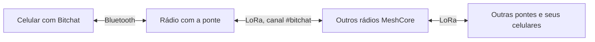
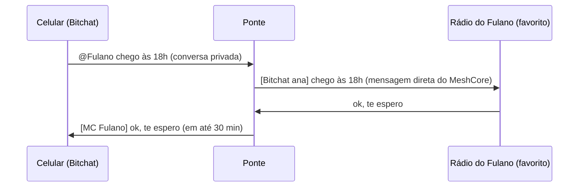
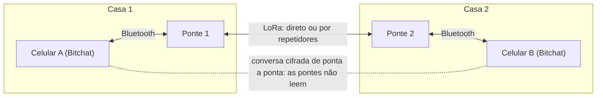

# Ponte Bitchat no MeshCore

Firmware _companion_ do MeshCore com uma ponte embutida para o aplicativo
[Bitchat](https://github.com/permissionlesstech/bitchat). Um telefone com o Bitchat, perto do
rádio, conversa com quem está na malha MeshCore, e o contrário, sem internet e sem servidor.

**Estado na versão `bitchat1.2`.** Ensaiado em aparelho pelo autor: o texto público entre o
Bitchat e o MeshCore (Heltec V3); a conversa privada com a ponte (Heltec V3 e T1000-E); o envio de
`@contato` a um favorito do rádio; e o túnel entre um Heltec V3 e um T1000-E, com a conversa privada
entre os dois celulares funcionando (`bitchat1.0`). As mudanças do túnel na `bitchat1.2` (presença a
cada 40 segundos) foram testadas só no computador. Não há medições de alcance, consumo ou duração. O resto
(resposta pelo `@contato`, túnel com repetidores no caminho, pagamentos Cashu, hora pelo LoRa,
histórico, funções da casa) e os demais aparelhos da [lista](DEVICES.md) foram testados no
computador e compilados, sem ensaio em aparelho.

O que está pronto, o que vem em seguida e o que ainda é estudo: [roteiro](ROADMAP.md).
O ensaio em aparelho: [roteiro de ensaio](TESTING.md).

## Documentos

| Documento                          | Assunto                                                  |
| ---------------------------------- | -------------------------------------------------------- |
| Este guia                          | O que a ponte faz, instalação, comandos, limites         |
| [Aparelhos](DEVICES.md)            | Lista de arquivos por aparelho; Heltec V4: qual dos dois |
| [Pagamentos Cashu](CASHU.md)       | Pagar pelo LoRa, garantias, limites e roteiro de ensaio  |
| [T-Deck com WadaMesh](WADAMESH.md) | O firmware de tela de toque com a ponte                  |
| [T-Deck](TDECK.md)                 | O arquivo MeshCore comum para o T-Deck                   |
| [Cardputer ADV](CARDPUTER.md)      | Conversa no aparelho, teclado e diagnóstico              |
| [T1000-E](T1000E.md)               | O nRF52 experimental, som e luz                          |
| [Privacidade](PRIVACY.md)          | O que se vê no ar, canais com chave própria              |
| [Roteiro](ROADMAP.md)              | Pronto, em seguida, fora do alcance                      |
| [Roteiro de ensaio](TESTING.md)    | O ensaio em aparelho                                     |
| [Versão atual](RELEASE.md)         | O que há de novo; é o texto da página de cada versão     |
| [Histórico](HISTORY.md)            | Notas das versões anteriores                             |

## O que faz



a) **Bitchat → MeshCore.** Texto público do `#mesh` do Bitchat sai no canal `#bitchat` do
MeshCore como `apelido: texto`, que é o formato nativo das mensagens de canal. Quem usa o
aplicativo MeshCore vê o apelido como remetente.

b) **MeshCore → Bitchat.** Texto do canal `#bitchat` chega aos telefones Bitchat próximos como
`[MC nome] texto`, sob a identidade da ponte (`LoRa bridge xxxx`).

c) **Entre telefones Bitchat.** A ponte também repassa por Bluetooth o que um telefone envia aos
outros conectados a ela, como um participante comum da malha Bitchat.

d) **Os dois aplicativos ao mesmo tempo.** O aplicativo MeshCore e o Bitchat usam o rádio juntos,
inclusive no mesmo telefone. Não há modo a trocar por botão.

e) **Sem configuração.** Na primeira partida a ponte liga sozinha e cria o canal `#bitchat`. O
canal é do tipo "hashtag": a chave deriva do nome, de modo que qualquer pessoa entra nele pelo
aplicativo MeshCore digitando `#bitchat`. **Não é um canal reservado.**

f) **Pagamentos Cashu (experimental).** Um token Cashu colado no chat
público do Bitchat vai, inteiro e assinado por quem paga, até as outras pontes do mesmo canal, que
o entregam aos celulares perto delas; quem paga recebe a confirmação. Só tokens travados para a
chave de quem recebe passam pelo canal `#bitchat`. Como usar e os limites: [pagamentos](CASHU.md).

g) **Conversa privada com a ponte.** No Bitchat, a ponte aparece como uma pessoa; na conversa
privada com ela, basta a palavra (`bateria`, `quem`, `ajuda`...). Detalhes mais abaixo.

h) **Mensagem a um contato do rádio.** Na conversa com a ponte, `@Fulano texto` vai ao contato
Fulano pelo LoRa, só se ele for favorito do dono do rádio. A ponte lê o texto.

i) **Túnel: conversa privada entre casas.** Quem está perto de outra ponte aparece no Bitchat e
conversa no privado, de ponta a ponta, pelo LoRa. Vem ligado; o dono desliga.

Só texto atravessa a ponte. Fotos, áudio e arquivos ficam no Bluetooth: no LoRa, uma foto ocuparia o
canal por minutos.

## Aparelhos

| Aparelhos                                                | Estado                                              |
| -------------------------------------------------------- | --------------------------------------------------- |
| Heltec V3 (ESP32-S3, SX1262)                             | Funcionou no ensaio do autor                        |
| Outros ESP32, ESP32-S3 e ESP32-C3 da [lista](DEVICES.md) | Compilam; nenhum foi ligado                         |
| ESP32-C6                                                 | Fora: a biblioteca Bluetooth usada não os atende    |
| M5Stack Cardputer ADV com Cap LoRa-1262                  | Ligado pelo autor. [Notas](CARDPUTER.md)            |
| LilyGo T-Deck e T-Deck Plus (sem uso do teclado)         | Compila; não foi ligado. [Notas](TDECK.md)          |
| T-Deck e T-Deck Plus com WadaMesh (tela de toque)        | Compila; não foi ligado. [Guia](WADAMESH.md)        |
| SenseCAP T1000-E (nRF52)                                 | Experimental; ligado pelo autor. [Notas](T1000E.md) |
| RAK4631, T-Echo, T114, ThinkNode M1, Xiao nRF52 (nRF52)  | Experimental; compilam; não foram ligados           |

**Em cada versão saem os aparelhos populares:** a partir da `bitchat0.24`, 27 aparelhos (Heltec,
LilyGo, RAK, Seeed, Elecrow, Station G2, M5Stack; os nRF52 mais comuns entre eles; lista completa em
[DEVICES.md](DEVICES.md)), com o pacote do Brasil, e o T-Deck com WadaMesh (a partir da
`bitchat0.23`). Os demais aparelhos da [lista](DEVICES.md) e os outros países são compilados
sob pedido, numa execução à parte (no GitHub, _Actions_ > _Bitchat bridge_ > _Run workflow_, com
_scope_ `all`), e continuam nas versões anteriores.

Há um arquivo por aparelho, com o mesmo nome do firmware _companion_ Bluetooth original e o final
`_bitchat`. Nos aparelhos sem memória PSRAM (ESP32 clássico e C3) a ponte pode recusar-se a ligar
por falta de memória e avisar `Low memory: bridge OFF`; o rádio segue como MeshCore comum.

## Arquivos por país

A página de cada versão traz, além dos arquivos gerais, o pacote do **Brasil**. Os demais pacotes
saem nas execuções sob pedido (ver "Aparelhos"):

| Pacote                 | Frequência  | Banda    | SF  | CR  | _Hash_ do caminho |
| ---------------------- | ----------- | -------- | --- | --- | ----------------- |
| `Brasil`               | 923,125 MHz | 62,5 kHz | 8   | 8   | 2 bytes           |
| `EUA`                  | 910,525 MHz | 62,5 kHz | 7   | 5   | 1 byte            |
| `Europa-e-Reino-Unido` | 869,618 MHz | 62,5 kHz | 8   | 8   | 1 byte            |
| `Rede-propria-918-MHz` | 918,000 MHz | 62,5 kHz | 8   | 8   | 2 bytes           |

Os valores de rádio são os das predefinições do aplicativo oficial (`Brazil`, `USA` e
`EU/UK (Narrow)`), lidas em <https://api.meshcore.nz/api/v1/config> em 2026-11-15; os 2 bytes do
Brasil seguem a [comunidade MeshCore Brasil](https://meshcore.com.br/valores-de-referencia/).

a) Dentro de cada pacote há uma pasta com os arquivos de todos os aparelhos, as somas de
conferência e um `LEIA-ME.txt`.

b) O programa é o mesmo dos arquivos gerais. Muda só o rádio com que um aparelho **nunca
configurado** começa. Gravado do zero com o pacote do país, o rádio já sai na frequência certa e
**não precisa do aplicativo MeshCore**: a ponte cria o canal e toma a hora do primeiro telefone
Bitchat.

c) Na atualização (arquivo sem `merged`, ou T1000-E que já rodava MeshCore), a configuração que
o aparelho tinha é mantida, inclusive a frequência antiga.

d) Os arquivos gerais continuam saindo em 869,618 MHz, 62,5 kHz, SF 8, CR 5, como o MeshCore
original, e pedem o ajuste da frequência pelo aplicativo.

e) Transmitir em frequência não permitida no lugar de uso pode ser proibido. O cumprimento da
regra local é de quem usa o rádio.

f) **`Rede-propria-918-MHz`** não fala com a rede da comunidade (923,125 MHz). É para casas sem
repetidor por perto: todos os rádios gravados com ele repassam o que ouvem (`Ativar Modo de
Repetição` já vem ligado) e formam uma malha à parte. O MeshCore só permite essa repetição em
433, 869,495 e 918 MHz; 918 MHz está na faixa de 915 a 928 MHz usada no Brasil. Repassar ocupa
mais tempo de transmissão e gasta mais bateria.

Os pacotes por país compilam, e o ajuste foi conferido no arquivo gerado; **nenhum foi ligado em
aparelho**.

## Instalação

Cada aparelho tem dois arquivos na página da versão: `<aparelho>_bitchat.bin` e
`<aparelho>_bitchat-merged.bin`. **Gravar o arquivo de outro aparelho pode impedir o rádio de
ligar**; confira o nome.

a) **Rádio com outro firmware (Meshtastic, por exemplo) ou novo:** apagar a memória e gravar o
arquivo `merged` no endereço `0x0`. Tudo o que havia no rádio é perdido.

b) **Rádio que já roda o MeshCore _companion_ Bluetooth:** gravar o arquivo sem `merged` no
endereço `0x10000`. Contatos, canais e identidade do rádio são mantidos.

### Pelo navegador

Este caminho não foi conferido pelo autor; o do terminal, sim. No Chrome ou no Edge, em um computador, abrir <https://espressif.github.io/esptool-js/>, conectar
o rádio pelo cabo USB e clicar em **Connect**. Para o caso (a): **Erase Flash**, depois endereço
`0x0`, escolher o arquivo `merged` e **Program**. Para o caso (b): endereço `0x10000`, escolher o
arquivo sem `merged` e **Program**, sem apagar. Ao fim, apertar o botão `RST` do rádio.

### Pelo terminal

Com o [esptool](https://docs.espressif.com/projects/esptool/) instalado (`pip install esptool`).
Cópia de segurança completa do que está no rádio, para poder voltar (tamanho de 8 MB, o do Heltec
V3; outros aparelhos têm outros tamanhos):

```bash
python -m esptool --chip esp32-s3 -b 921600 read_flash 0x0 0x800000 backup.bin
```

Caso (a):

```bash
python -m esptool --chip esp32-s3 erase_flash
```

```bash
python -m esptool --chip esp32-s3 write_flash 0x0 Heltec_v3_companion_radio_ble_bitchat-merged.bin
```

Caso (b):

```bash
python -m esptool --chip esp32-s3 write_flash 0x10000 Heltec_v3_companion_radio_ble_bitchat.bin
```

Em aparelhos com outro chip, trocar `esp32-s3` por `esp32` ou `esp32-c3`.

**Volta ao original:** gravar o firmware oficial pelo [gravador do MeshCore](https://flasher.meshcore.io),
ou a cópia de segurança no endereço `0x0`.

## Primeiro uso

1. Ligar o rádio. O nome Bluetooth continua `MeshCore-…`.
2. Abrir o aplicativo MeshCore e conectar. O PIN aparece na tela do rádio. **Se o telefone já
   estava pareado com esse rádio**, pode ser preciso removê-lo nos ajustes de Bluetooth do
   telefone e parear de novo: este firmware usa outra pilha Bluetooth, com outro registro de
   pareamentos.
3. Conferir a frequência e a predefinição de rádio no aplicativo, como em qualquer MeshCore. A
   ponte não altera isso.
4. Conferir se existe o canal `#bitchat`. Enviar `!bridge` nele: a resposta chega no próprio canal,
   como mensagens de `bridge`.
5. Abrir o Bitchat perto do rádio. No primeiro minuto depois de ligado, o rádio ainda se anuncia
   como o firmware original e o Bitchat não o encontra; o estado mostra `Bitchat starts: N s`.
   Passado esse minuto, esperar mais um e enviar `!bridge` de novo: `Bitchat` e `people` devem
   passar de zero.
6. Escrever no `#mesh` do Bitchat. O texto deve aparecer no canal `#bitchat` do aplicativo
   MeshCore deste rádio e dos outros da malha que tenham o canal.

Sem o aplicativo MeshCore por perto, a ponte funciona do mesmo modo: ela toma a hora do
primeiro telefone Bitchat que se apresenta ou dos anúncios dos rádios MeshCore ao alcance (veja
"Hora pelos anúncios do LoRa", abaixo). A frequência do rádio, porém, precisa estar certa:
ou ajustada antes pelo aplicativo, uma vez, ou vinda de um [arquivo do país](#arquivos-por-país).

### Várias casas, cada uma com um rádio

a) **Pela rede existente:** o rádio de conversa do MeshCore não repassa mensagens de outros;
quem repassa são os repetidores. As casas conversam se cada uma alcança um repetidor, ou se os
rádios se alcançam diretamente.

b) **Rede própria:** o MeshCore deixa o rádio de conversa repassar mensagens (`Ativar Modo de
Repetição`) somente em 433,000, 869,495 e 918,000 MHz. O pacote `Rede-propria-918-MHz` já sai
assim, sem o aplicativo: todos os rádios gravados com ele formam uma malha à parte, fora da rede
dos repetidores. Não foi ensaiado.

c) O texto público do `#mesh` e os anúncios do túnel vão ao LoRa num canal que qualquer pessoa pode
ler. Para que quem está fora do grupo não leia, use um canal com chave própria; ver o
[estudo de privacidade](PRIVACY.md).

## Comandos

Digitados no aplicativo MeshCore, em qualquer canal do rádio que tem a ponte. São respondidos só
nesse aplicativo e **não são transmitidos**.

| Comando                 | Efeito                                                                               |
| ----------------------- | ------------------------------------------------------------------------------------ |
| `!bridge`               | Mostra o estado, os contadores e uma linha por conexão Bluetooth                     |
| `!bridge on`            | Liga a ponte                                                                         |
| `!bridge off`           | Desliga a ponte; o rádio segue como MeshCore comum                                   |
| `!bridge local`         | Só Bluetooth: os telefones Bitchat se falam pelo rádio, nada vai ao LoRa             |
| `!bridge lora`          | Passa a usar o canal em que o comando foi digitado (o canal `Public` não vale)       |
| `!bridge link on`       | Liga a passagem de texto vindo de pontes Meshtastic (padrão)                         |
| `!bridge link off`      | Desliga essa passagem; o texto delas fica só no Bitchat                              |
| `!bridge economy on`    | Liga o modo econômico (ver abaixo); em português, `!ponte economia on`               |
| `!bridge economy off`   | Desliga o modo econômico (padrão)                                                    |
| `!bridge reset`         | Derruba as conexões Bluetooth para os telefones lerem os serviços de novo            |
| `!bridge who`           | Lista os nomes ouvidos no canal LoRa nas últimas seis horas, em inglês               |
| `!ponte quem`           | A mesma lista, em português                                                          |
| `!bridge guide`         | Explica a ponte em quatro mensagens curtas, em inglês                                |
| `!ponte guia`           | O mesmo guia, em português                                                           |
| `!bridge prefix on`     | Só o texto do `#mesh` iniciado por `!lora` vai ao LoRa; `!ponte prefixo on`          |
| `!bridge prefix off`    | Todo o texto público do `#mesh` vai ao LoRa (padrão)                                 |
| `!ponte recado <texto>` | Deixa o recado da casa (ver abaixo); sem texto, mostra o recado atual                |
| `!ponte recado apagar`  | Apaga o recado (`!bridge note off` em inglês)                                        |
| `!ponte bateria`        | Tensão e carga aproximada da bateria do rádio                                        |
| `!ponte radios`         | Rádios ouvidos no LoRa nas últimas 24 horas, do mais recente ao mais antigo          |
| `!ponte sos <texto>`    | Pedido de socorro ao LoRa, com a posição do rádio, se ele a tiver                    |
| `!ponte teste`          | Teste de alcance com as outras pontes (ver abaixo)                                   |
| `!bridge position on`   | Socorro pedido pelo Bitchat leva a posição do rádio (trilha); `off` desliga (padrão) |
| `!ponte som off`        | O rádio para de apitar (`on` volta); guardado no rádio                               |
| `!ponte luz off`        | A luz de aviso fica apagada (`on` volta); guardado no rádio                          |
| `!ponte privado off`    | Desliga as mensagens privadas do Bitchat aos contatos do LoRa (`on` volta; padrão)   |
| `!ponte túnel off`      | Desliga as conversas privadas entre casas diferentes (`on` volta; vem ligado)        |
| `!ponte ajuda`          | Lista os comandos em cinco mensagens (`!bridge help` em inglês)                      |

`!ponte` vale no lugar de `!bridge`, e a resposta sai em português quando se usa `!ponte` ou a
palavra em português (`ajuda`, `recado`, `bateria`, `socorro`, `teste`, `economia`, `prefixo`,
`privado`, `túnel`). Em inglês: `help`, `note`, `battery`, `radios`, `sos`, `test`, `economy`,
`prefix`, `dm`, `tunnel`.

No Bitchat, escritos no `#mesh`, valem todos, menos os que mudam a configuração: o estado
(`!bridge`), os nomes (`!ponte quem`), o guia (`!ponte guia`, no máximo uma vez a cada 30
segundos), o recado, a bateria, os rádios, o socorro e o teste. As respostas vão a todos os
telefones próximos, uma a cada cinco segundos. Os comandos que mudam a configuração (`on`, `off`,
`local`, `lora`, `link`, `economy`, `prefix`, `reset`, `som`, `luz`, `privado`, `túnel`) só valem no
aplicativo MeshCore; no Bitchat, no `#mesh` ou na conversa privada, recebem o aviso de que só o dono
os muda. O guia diz se o texto está indo ao LoRa e se o túnel está ligado.

O `/who` do Bitchat só mostra quem está na malha Bluetooth; quem fala pelo LoRa não aparece ali.
`!bridge who` cobre essa falta: lista até doze nomes, do mais recente ao mais antigo, e, quando
nem todos cabem em uma mensagem, informa quantos ficaram de fora (`+3`). A lista fica na memória
do rádio e some ao desligar.

## Funções da casa

Todas foram testadas no computador e compiladas; nenhuma foi ensaiada em aparelho.

a) **Só com `!lora`.** Com `!bridge prefix on`, o texto do `#mesh` só vai ao LoRa quando começa por
`!lora ` (a marca é retirada antes do envio). O resto fica entre os telefones da casa. O texto que
outras pontes trazem segue a regra de `!bridge link`, não esta. A escolha fica gravada; `!bridge`
mostra `(!lora)` ao lado do canal, e o guia passa a explicar a marca.

b) **Recado da casa.** `!ponte recado Jantar às 20h` guarda um recado de até 55 bytes, com o nome
de quem o deixou (o nome do rádio, se veio do aplicativo MeshCore; o apelido, se veio do Bitchat).
Cada telefone Bitchat que chega e se anuncia diretamente ao rádio recebe o recado uma vez a cada
12 horas, só ele, numa mensagem que os outros telefones não repassam. O recado fica gravado e
sobrevive ao reinício; um recado novo vai de novo a todos. No Bitchat, o recado só é trocado por um
telefone ligado diretamente ao rádio (não por um que chega pela malha de outros telefones), no
máximo uma vez a cada dez minutos, porque cada troca é gravada na memória do rádio. **Qualquer
pessoa perto do rádio, com o Bitchat, pode trocar ou apagar o recado.**

c) **Rádios ao alcance.** `!ponte radios` lista os contatos MeshCore com atividade nas últimas 24
horas, pelo relógio do rádio, com o número de saltos quando a rota é conhecida (`direto`,
`2 saltos`). O MeshCore não guarda o sinal de cada contato, de modo que a lista não traz SNR.
**Só no aplicativo MeshCore do próprio rádio.** A atividade de um contato inclui mensagens
privadas trocadas com ele, de modo que a lista diria a estranhos com quem o dono conversa e
quando; no Bitchat, o comando responde que a lista fica no aplicativo.

d) **Bateria.** `!ponte bateria` responde com a tensão e uma carga aproximada, calculada por uma
curva típica de bateria de lítio, que não vale para outras baterias. Quando a tensão cai abaixo
de 3,45 V com algum telefone conectado, a ponte avisa no `#mesh` uma vez (`Bateria baixa /
Battery low`); o aviso volta a valer depois que a tensão passar de 3,6 V. Rádio que não mede a
bateria responde que não informa a carga e não avisa.

e) **Pedido de socorro.** `!ponte sos caí na trilha` envia ao LoRa `apelido: SOS: caí na trilha`.
Digitado no aplicativo MeshCore do próprio rádio, leva a posição que o rádio tiver (definida no
aplicativo ou dada pelo GPS), como `(-23.55052, -46.63331)`. Pedido pelo Bitchat, que qualquer
pessoa por perto usa, só leva a posição se o rádio já a divulga nos anúncios (ajuste de
localização do aplicativo MeshCore) ou se o dono ligou `!bridge position on` (próprio para trilha:
o socorro pelo Bitchat leva a posição sem que o rádio a divulgue nos anúncios; `!bridge position
off` desliga, e é o padrão); senão, vai sem ela. Sem texto, vai `pedido de socorro`. Vale
com o prefixo ligado e está limitado a um a cada cinco minutos. **A posição, quando vai, chega a
todos os que têm o canal.** Não substitui serviço de emergência: o LoRa não confirma a entrega, e
não se sabe se alguém está ouvindo.

f) **Teste de alcance.** `!ponte teste` envia `nome: #ponte-teste 1234`. Cada ponte MeshCore que
ouvir responde uma vez com o sinal com que ouviu (`#ponte-teste 1234 ouvido -4.5 dB`; `? dB`
quando a mensagem chegou por um repetidor, porque o sinal medido é o do repetidor), e quem
pediu recebe, em até dois minutos, `Teste 1234: Casa Ana ouviu com -4,5 dB; a volta chegou com
-6,0 dB.`, ou o aviso de que ninguém respondeu. As linhas do teste não vão aos telefones como
texto comum, mas aparecem no aplicativo MeshCore de quem tem o canal. Um teste por vez.
Um `!ponte sos` ou `!ponte recado` digitado em **outro** rádio chega aos telefones como texto comum
dessa pessoa; só o rádio da ponte obedece aos comandos digitados nele.

g) **Hora pelo GPS.** Em rádio com GPS desligado, se em 30 segundos nada tiver dado a hora (nem o
aplicativo, nem um telefone), a ponte liga o GPS por até dez minutos; o próprio MeshCore acerta o
relógio com o GPS. Quando a hora fica certa, ou ao fim dos dez minutos, o GPS volta a ficar
desligado. Sem hora, tenta de novo a cada seis horas. O GPS **não** é ligado quando o rádio está
configurado para incluir a posição nos anúncios, para que a posição do GPS não substitua a que o
operador escolheu divulgar. Ao desligar o GPS, a ponte devolve ao rádio a posição que ele tinha
antes: a posição do GPS não fica guardada.

h) **Hora pelos anúncios do LoRa.** Cada rádio MeshCore manda anúncios ("adverts") assinados com a
hora do próprio relógio. Sem outra fonte de hora (aplicativo, GPS ou telefone), a ponte adota a
hora do primeiro anúncio que ouvir, como hora provisória. Outro rádio sozinho, discordando, não a
muda; **dois rádios** que concordam com diferença de até um minuto a substituem (a mais cedo das
duas), e um telefone com Bitchat a substitui sempre. A hora nunca fica antes da data em que o
firmware foi compilado nem da última hora confiável guardada, e o relógio do rádio não é alterado.
No diagnóstico do `!bridge` aparece como `lora`. Com o aplicativo MeshCore conectado, a hora dele vale
mais, e a do LoRa não é usada.

## Conversa privada com a ponte

No Bitchat, a ponte aparece na lista de pessoas como `LoRa bridge` seguido de quatro caracteres.
Tocando nela, abre-se uma conversa privada, como com qualquer pessoa, e os pedidos feitos ali têm
resposta só ali, sem aparecer no chat público.

a) **Basta a palavra:** `ajuda`, `bateria`, `quem`, `guia`, `teste`, `recado <texto>`,
`sos <texto>`, ou `ponte` para o estado (em inglês, `help`, `battery`, `who`, `guide`, `test`,
`note`, `sos`, `bridge`). A resposta sai na língua da palavra. Os comandos completos
(`!ponte bateria`) também valem. Qualquer outra coisa recebe a ajuda em português.

b) **As regras são as do chat público:** a lista de rádios continua só no aplicativo do próprio
rádio, o recado só muda por quem está ligado diretamente ao rádio, e os ajustes (ligar, desligar,
som, luz, túnel) continuam só com o dono, e a ponte avisa isso. O que um pedido manda ao LoRa (um socorro, um
teste de alcance) vai ao LoRa como no chat público; o resultado do teste de alcance sai no chat
público, como antes.

c) **Criptografia:** a mesma das conversas privadas entre telefones (protocolo Noise, com a chave
que a ponte anuncia). Cada mensagem recebida é confirmada como entregue. A ponte mantém até três
conversas ao mesmo tempo; a que ficou mais tempo parada dá lugar a uma nova, e uma conversa parada
por 30 minutos é encerrada. Depois de reiniciar o rádio, a primeira mensagem refaz a conversa
sozinha.

d) **Mensagens a contatos do LoRa e conversas entre casas:** veja as duas seções seguintes.

e) **Ensaiada em aparelho** pelo autor, com o Bitchat para iPhone, num Heltec V3 e num T1000-E.
O protocolo foi também conferido byte a byte com uma implementação independente do Noise.

f) **Limite nos rádios nRF52** (T1000-E, RAK4631 e outros): uma mensagem privada com mais de cerca
de 150 caracteres (menos, com acentos) não chega a eles; nos ESP32 chega.

## Mensagem privada a um contato do LoRa

Na conversa privada com a ponte, `@Nome texto` manda o texto ao contato `Nome` do rádio, como
mensagem direta do MeshCore. Exemplo: `@Fulano chego às 18h`.



a) **Só aos favoritos do dono.** Valem apenas os contatos que o dono marcou como favoritos no
aplicativo MeshCore (a estrela). Assim, quem passa perto da casa com o Bitchat não escreve a
qualquer contato do rádio, nem descobre quem está na lista: para um nome que não existe e para um
que não é favorito, a resposta é a mesma.

b) **O nome** é o do contato, em maiúsculas ou minúsculas; vale o nome mais longo que combina, então
`@Fulano de Tal oi` vai para "Fulano de Tal", não para "Fulano". Depois do nome, um espaço ou `:`.

c) **Quem recebe vê** `[Bitchat ana] chego às 18h`, vindo do rádio da ponte, com a data do relógio da
ponte. Cabe uma mensagem do MeshCore (160 bytes, com o apelido); o que passa disso é recusado, não
cortado. Quebras de linha viram espaços.

d) **A resposta volta** à mesma conversa privada, como `[MC Fulano] texto`, quando o contato responde
ao rádio da ponte **em até 30 minutos**. Depois disso, ou a qualquer hora, um favorito pode escrever
ao rádio da ponte começando com `@apelido` de quem está no Bitchat: `@ana o portão está aberto`.
Mensagens de quem não é favorito nunca vão ao Bitchat.

e) **Se o celular não estiver perto**, a mensagem fica guardada por até 24 horas (três por celular,
três por contato, oito no total) e só sai da caixa quando o Bitchat do celular confirma que a
recebeu. Quando o celular volta e se apresenta à ponte, a ponte abre a conversa privada sozinha e
entrega.

f) **Limites:** duas mensagens por celular, depois uma a cada 20 segundos; para todos juntos, cinco,
depois uma a cada três minutos.

g) **Privacidade:** a ponte lê a mensagem (ela a tira da conversa criptografada do Bitchat e a manda
pela criptografia do MeshCore). As respostas aparecem também no aplicativo MeshCore do dono, como
qualquer mensagem direta ao rádio; o que a ponte manda em nome do rádio não aparece ali. Não é
criptografia de ponta a ponta entre o celular e o contato.

h) **O dono do rádio desliga** com `!ponte privado off` no aplicativo MeshCore (`on` religa); ao
desligar, o que estava guardado é apagado. Vem ligado.

## Conversa privada entre celulares de casas diferentes (túnel)

Quem está perto de uma ponte vê no Bitchat quem está perto de outra, e os dois conversam no privado
como se estivessem lado a lado. O túnel vem ligado; o dono desliga com `!ponte túnel off`, no
aplicativo MeshCore. As duas pontes precisam estar com ele ligado e se alcançar pelo LoRa, direto ou
por repetidores.



a) **Criptografia de ponta a ponta:** as pontes só carregam os pacotes do Bitchat, que já vêm
criptografados pelos celulares. Nenhuma ponte lê a conversa.

b) **O que vai pelo LoRa:** o anúncio de cada celular ligado diretamente à ponte (apelido e chaves
públicas, legíveis por quem tem a chave do canal) e os pacotes privados entre um celular daqui e um
de lá, só do próprio celular, pelo enlace Bluetooth em que ele se apresentou. O texto público
continua como antes. O anúncio, que mantém a pessoa na lista do Bitchat do outro lado, vai:

- **a cada 40 segundos**, pela própria ponte, enquanto houver celular perto das duas pontes (a outra
  mandou algo nos últimos 3 minutos): o Bitchat tira da lista, 60 segundos depois, quem chega
  retransmitido, e não manda nada a quem não está na lista. Vale para um celular por ponte na
  configuração de rádio brasileira, e até dois nas configurações mais rápidas, conforme o tempo de ar;
- a cada 3 minutos para os demais celulares, ou quando a outra ponte foi ouvida na última meia hora;
- a cada 30 minutos quando nenhuma outra ponte com túnel foi ouvida;
- nunca, se não houver celular perto da ponte.

c) **Custa tempo de rádio no canal**, que é compartilhado, mas só quando há celular por perto: sem
celular, o túnel não transmite nada. No ritmo de 40 segundos, cada celular ocupa cerca de 5% do tempo
do canal (estimativa, não medição), repetido por cada repetidor que encaminha. Em média, a ponte não
passa de 10% do tempo de rádio (pode usar mais por alguns segundos, quando estava parada), e o anúncio só sai quando sobra folga para as conversas e para a abertura
delas. A ponte reveza os pacotes do túnel com o texto público, para um
não segurar o outro. Pontes anteriores à `bitchat0.24` ignoram esses pacotes. Só texto: fotos e áudio
não passam.

d) **Proteções:** no máximo seis celulares de fora ocupam lugar na lista da ponte, sem nunca tirar o
lugar dos celulares da casa; um pacote que chega pelo LoRa em nome de um celular da casa é
descartado.

e) **Sem garantia de entrega:** o próprio Bitchat confirma as mensagens e reenvia o que não foi
confirmado. Com o LoRa congestionado, ou com vários repetidores no caminho, abrir a conversa pode
exigir outra tentativa: o Bitchat do iPhone desiste da abertura em cerca de 10 segundos.

f) **Como saber se passou pelo túnel:** no Bitchat, a pessoa da outra casa aparece com o símbolo de
três pontos ligados ("retransmitido por outros"). A anteninha indica que os celulares se alcançam
direto pelo Bluetooth, e o globo, que o Bitchat usou a internet. Os três pontos também aparecem
quando a ponte repassa pelo Bluetooth um celular que ela mesma alcança; a prova é o `!ponte`, no
aplicativo MeshCore: a linha `Tunnel: out N, in M, far phones K` mostra os pedaços enviados pelo
túnel, os pacotes recebidos dele e os celulares do outro lado que a ponte conhece. Para ensaiar só
o túnel, deixe os celulares sem internet e fora do alcance do Bluetooth um do outro.

g) **Abrir a conversa leva segundos:** a abertura vai e volta pelo LoRa e precisa caber nos cerca
de 10 segundos que o Bitchat do iPhone espera. A ponte manda os pedaços da abertura assim que o rádio
fica livre, sem o intervalo que guarda entre os outros envios. Se não abrir, tente de novo.

h) **Ensaio em aparelho:** entre um Heltec V3 e um T1000-E, a conversa privada entre os dois
celulares funcionou. Quando duas pontes se ouvem pelo Bluetooth, uma fica de reserva para o texto
público; até a `bitchat0.25`, isso parava também o túnel dela, e a `bitchat1.0` corrigiu.

## Histórico para quem chega depois

O Bitchat guarda as mensagens públicas recentes e entrega a quem chega as que faltam; é o que o
aplicativo mostra como "ouvido aqui antes". A ponte participa disso com o texto que traz do LoRa.

a) O texto do canal é assinado e guardado mesmo sem nenhum telefone conectado. Quando um telefone
chega, o próprio Bitchat pergunta o que falta e a ponte entrega, três mensagens por vez, da mais
nova para a mais antiga; o telefone repete a pergunta a cada 15 segundos, e o restante segue.

b) Ficam guardadas as últimas 24 mensagens (8 no T1000-E), por até seis horas, na memória do
rádio. Desligar o rádio, ou `!bridge off`, apaga tudo.

c) A partir da `bitchat0.10`, entra também o que os telefones escrevem no `#mesh` perto do rádio,
com a assinatura de quem escreveu: a ponte faz o papel de um telefone que fica em casa. Quem
chega depois só vê essas mensagens se já conheceu o autor antes; o Bitchat aceita o anúncio de
uma pessoa por 15 minutos e, depois disso, usa as identidades que guardou. Mensagens com 100
bytes ou mais (que o Bitchat compacta) não são guardadas. As últimas mensagens, das duas
origens, dividem a mesma tabela.

d) Depois de religado sem ninguém por perto, o rádio fica sem hora e não consegue assinar: o
texto que chegar até o primeiro telefone (ou o aplicativo MeshCore) aparecer se perde, como antes.

e) `!bridge` mostra `Kept N`, o número de mensagens guardadas.

O formato do pedido foi escrito a partir do código do aplicativo e conferido com valores
calculados à parte, mas **não foi ensaiado com o aplicativo real**.

## Consumo e modo econômico

Com a ponte ligada, o rádio gasta mais: anuncia-se por Bluetooth várias vezes por segundo, mantém
ligação com cada telefone Bitchat próximo e transmite pelo LoRa o que leva do Bitchat. O consumo não
foi medido.

a) **Modo econômico, opcional:** vem desligado. `!bridge economy on` liga, `!bridge economy off`
desliga, e a escolha fica gravada. Ligado, depois de três minutos sem nenhum telefone Bitchat falando
com o rádio, ele passa a se anunciar cerca de uma vez por segundo e a ponte examina as filas com menos
frequência. O primeiro telefone que falar traz o ritmo normal de volta. `!bridge` mostra `Economy off`,
`Economy on` (ligado, em ritmo normal) ou `Economy active` (ligado, em ritmo lento).

Enquanto o ritmo está lento, o Bitchat pode demorar mais para encontrar o rádio. O aplicativo MeshCore
também: passado o primeiro minuto depois de ligar o Bluetooth, ele acha o rádio pelo mesmo anúncio.
Depois de conectado, o uso é o normal. Nem o ganho de bateria nem essa demora foram medidos.

b) **Ponte desligada:** `!bridge off` desliga tudo o que é da ponte, e a escolha fica gravada. É o
recomendado quando a ponte não está em uso. `!bridge on` religa.

## Ligação com o Meshtastic

Quando uma ponte deste projeto e uma ponte [Meshtastic–Bitchat](https://github.com/EduChacon/meshtastic-bitchat)
estão ao alcance Bluetooth dos mesmos telefones Bitchat, as duas redes LoRa passam a conversar
pelo Bitchat, sem ajuste algum:

- o que a ponte Meshtastic traz ao Bitchat, `[MT nome] texto`, sai no canal do MeshCore como
  `MT nome: texto`;
- no sentido contrário, a ponte Meshtastic (a partir da `1.0.0-beta.6`) leva `[MC nome] texto` à
  rede dela como `MC nome: texto`.

Cada texto atravessa **uma vez só**: o que já veio da outra rede chega marcado e nenhuma ponte o
leva de volta. É preciso haver ao menos um telefone com o Bitchat aberto entre as duas pontes,
porque elas não se conectam uma à outra. `!bridge link off` desliga a passagem neste rádio.

Limites dessa ligação: com mais de um lugar ligando as mesmas duas redes, o mesmo texto pode
aparecer repetido; e ela **não foi ensaiada em aparelho**, só em simulação.

## Na tela do rádio

Nos rádios com tela há uma página **Bitchat bridge** entre as páginas iniciais, depois da de
Bluetooth. Ela mostra o estado, quantos telefones Bitchat estão falando com o rádio, quantas
pessoas são conhecidas e quantos textos foram e vieram pelo LoRa. Nessa página, o toque longo no
botão (ou Enter, nos aparelhos com teclas) troca o modo, nesta ordem: `Bitchat + LoRa`,
`Bitchat only`, `Off`. Ao voltar para `Bitchat + LoRa` por esse caminho, o canal usado é o
`#bitchat`.

## Limites conhecidos

a) Cada mensagem MeshCore leva até 160 bytes, remetente incluído. Texto maior do Bitchat é
dividido em até três partes (`apelido (1/3): …`); acima disso é recusado, não cortado.

b) No sentido contrário, cada mensagem para o Bitchat leva até 96 bytes, e o texto é dividido em
até cinco partes.

c) Até três conexões Bluetooth ao mesmo tempo, somando o aplicativo MeshCore e os telefones
Bitchat.

d) A ponte se limita, em média, a 10% do tempo de transmissão, além dos limites do próprio MeshCore. Com o
rádio ocupado, o texto espera até dois minutos e depois é descartado e contado em `lost`.

e) Duas pontes que se ouvem por Bluetooth e usam o mesmo canal: a de número maior fica em espera,
para não duplicar texto. Duas pontes que não se ouvem por Bluetooth podem levar o mesmo texto do
Bitchat duas vezes ao LoRa.

f) O nome anunciado no Bluetooth é abreviado para 11 caracteres enquanto a ponte está ligada
(`MeshCore-1A` em vez de `MeshCore-1A2B3C4D`), porque o anúncio leva os dois serviços. Não foi
verificado se o aplicativo MeshCore encontra o rádio em todos os telefones com esse anúncio.
Se não encontrar, reiniciar o rádio e conectar no primeiro minuto, em que o anúncio é o
original; a conexão feita nesse minuto continua depois dele.

g) A página da ponte na tela existe só na interface mais comum dos rádios com tela (`ui-new`). Em
aparelhos com outra interface, ou sem tela, o estado é lido por `!bridge`.

h) A ponte não acerta o relógio do firmware por conta própria. Sem o aplicativo MeshCore, as
mensagens que vêm do Bitchat saem com a hora certa, mas o resto do MeshCore segue com a hora que
tiver, salvo em rádio com GPS, que o próprio MeshCore acerta quando a ponte liga o GPS (item g
das funções da casa).

## O que muda em relação ao firmware original

a) **Pilha Bluetooth.** O original usa a pilha Bluedroid; este usa a NimBLE (biblioteca
NimBLE-Arduino 1.4.3), que permite ao rádio ler o serviço que o aplicativo Bitchat publica no
telefone. Esse é o caminho que funcionou com o Bitchat do iPhone na ponte para Meshtastic do
mesmo autor. O serviço do aplicativo MeshCore (Nordic UART) e o pareamento por PIN são os
mesmos.

b) **Anúncio.** Com a ponte ligada, o rádio continua visível enquanto houver conexão livre, com o
serviço do Bitchat no anúncio e o do MeshCore na resposta de varredura. O original deixa de se
anunciar quando o aplicativo conecta. No primeiro minuto depois de ligar (ou de religar o
Bluetooth pelo botão), o anúncio é igual ao do original: é a garantia de que o aplicativo MeshCore
encontra o rádio.

c) **Serviço do Bitchat sem pareamento.** Qualquer telefone próximo pode conectar e trocar
pacotes do Bitchat, que são públicos e assinados. O serviço do MeshCore continua exigindo
pareamento, e as notificações dele devem ir só a conexões cifradas. **Isso não foi verificado em
aparelho**; o [roteiro de ensaio](TESTING.md) inclui a conferência.

d) **Memória.** A ponte reserva seus blocos ao ligar e os devolve ao desligar; se faltar memória,
ela se desliga e informa `Low memory: bridge OFF`. O consumo real não foi medido.

## Para quem desenvolve

| Onde                                                          | O que há                                                        |
| ------------------------------------------------------------- | --------------------------------------------------------------- |
| `src/helpers/bitchat/`                                        | Núcleo da ponte (codec, assinaturas, estado, Bluetooth, texto)  |
| `src/helpers/bitchat/BitchatBridge.*`                         | Ligação com o MeshCore: canal, relógio, comandos, filas         |
| `src/helpers/bitchat/Bridge{Cashu,Inflate,Tunnel,Payments}.*` | Pagamentos Cashu pelo LoRa                                      |
| `src/helpers/bitchat/Bridge{Noise,Private}.*`                 | Conversa privada com a ponte (Noise XX, sessões, respostas)     |
| `src/helpers/bitchat/esp32/`, `nrf52/`                        | Interface Bluetooth do _companion_ (NimBLE; Bluefruit no nRF52) |
| `examples/companion_radio/`                                   | Pontos de contato com a ponte e ajustes de bipe e luz           |
| `variants/bitchat/platformio.ini`                             | Ambientes de compilação (gerados)                               |
| `integrations/wadamesh/`                                      | Encaixe da ponte no WadaMesh ([guia](WADAMESH.md))              |
| `test/bitchat/`                                               | Testes em computador                                            |
| `tools/bitchat/`                                              | Scripts ([lista](../../tools/bitchat/README.md))                |
| `.github/workflows/bitchat-bridge.yml`                        | Compilação e publicação no GitHub                               |

Os arquivos originais do MeshCore mudam em `MyMesh.h`, `MyMesh.cpp`, `main.cpp`, `NodePrefs.h` e nas
interfaces de tela (`ui-*`), em blocos `#ifdef WITH_BITCHAT_BRIDGE` ou em ajustes que valem também
sem ponte (bipe e luz). Sem essa opção, o firmware compila como o original.

Compilar:

```bash
pio run -e Heltec_v3_companion_radio_ble_bitchat -t mergebin
```

Depois de trazer mudanças do MeshCore oficial, refazer a lista de ambientes:

```bash
python tools/bitchat/generate_envs.py
```

Testes em computador (sem aparelho), depois de uma compilação ter baixado as bibliotecas:

```bash
python tools/bitchat/run_tests.py --crypto-dir .pio/libdeps/Heltec_v3_companion_radio_ble_bitchat/Crypto
```

A definição do Cardputer ADV e a interface de teclado vêm do projeto
[MeshCore-Cardputer-ADV](https://github.com/Stachugit/MeshCore-Cardputer-ADV), de Stachu (licença
MIT), como descrito nas [notas](CARDPUTER.md).

O núcleo veio da ponte para Meshtastic do mesmo autor
([EduChacon/meshtastic-bitchat](https://github.com/EduChacon/meshtastic-bitchat), _commit_
`47d4d67`). A base é o MeshCore oficial no _commit_ `75b04ef` (versão 1.18.0).

### O que falta

a) Ensaio em aparelho dos demais modelos e medições (alcance, consumo, duração); ensaio do túnel com
os celulares fora do alcance um do outro e da hora pelo LoRa.

b) Os nRF52 da `bitchat0.24` (RAK4631, T-Echo, T114, ThinkNode M1, Xiao nRF52) só foram
compilados; o Bluetooth deles é o mesmo do T1000-E.

c) Página da ponte nas outras interfaces de tela (`ui-orig`, `ui-tiny`).

d) ESP32-C6, que depende de outra versão da biblioteca Bluetooth.
